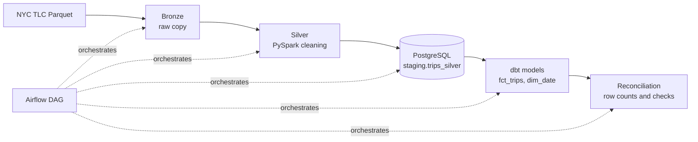

# NYC Taxi ELT Pipeline


An end-to-end ELT pipeline for NYC yellow taxi trips. Raw Parquet files are cleaned with PySpark, loaded into PostgreSQL, modeled into a star schema with dbt, orchestrated with Airflow in Docker, and checked by a reconciliation step and GitHub Actions CI.

## Architecture



## Tech stack

- **Processing:** Python, PySpark 3.5.1
- **Storage:** PostgreSQL 16 (Docker)
- **Modeling and tests:** dbt 1.8.2 (star schema, unique and not-null tests)
- **Orchestration:** Apache Airflow 2.9.3 (Docker)
- **CI:** GitHub Actions

## Pipeline layers

| Layer | Script | What it does |
|---|---|---|
| Raw | `data/raw/` | Original files, never edited |
| Bronze | `src/bronze.py` | Copies raw data into a month-partitioned folder |
| Silver | `src/silver.py` | Removes invalid and duplicate rows, adds a trip ID hash |
| Load | `src/load.py` | Deletes the month's rows, then loads Silver into Postgres |
| Models | `dbt_project/taxi_dbt` | Builds `fct_trips` and `dim_date` with tests |
| Reconcile | `quality/reconcile.py` | Checks row counts across layers and fails on mismatches |

## Results (January 2024)

- Bronze: 2,964,624 rows
- Silver: 2,754,887 rows (209,737 invalid or duplicate rows removed)
- Fact table: 2,754,887 rows, all trip IDs unique
- Reconciliation: passes at every layer, with zero invalid rows

## Data quality checks

- Silver filters: no pickup time, dropoff before pickup, zero or negative distance, negative fare, missing passenger count, exact duplicates
- dbt tests: `unique` and `not_null` on trip keys and fares
- Reconciliation: row counts match across Silver, staging, and fact; no duplicate IDs; no invalid values

## How to run

1. Start Postgres:
   ```bash
   docker compose -f docker-compose.yml up -d
   ```
2. Create a virtual environment and install packages:
   ```bash
   python3.11 -m venv .venv
   source .venv/bin/activate
   pip install -r requirements.txt
   ```
3. Download January 2024 data into `data/raw/`:
   - `yellow_tripdata_2024-01.parquet` from the NYC TLC trip record page
   - `taxi_zone_lookup.csv`
4. Run the layers in order:
   ```bash
   python src/bronze.py 2024-01
   python src/silver.py 2024-01
   python src/load.py 2024-01
   cd dbt_project/taxi_dbt && dbt build --profiles-dir . && cd ../..
   python quality/reconcile.py 2024-01
   ```
5. To run through Airflow, start it with `docker compose -p airflow-taxi -f docker-compose.yaml up -d`, then trigger `nyc_taxi_elt` once at a time.

## Design decisions

- **Delete-then-insert loads** make reruns idempotent. Overlapping runs would double the data, so the DAG allows only one active run.
- **Bronze keeps raw data unchanged**, so Silver can be rebuilt without re-downloading.
- **Trip ID is a SHA-256 hash of nine fields.** A narrower hash produced 519 duplicates, which dbt tests caught.
- **CI uses a 1,000-row sample** to stay fast. The full pipeline is verified locally in Airflow.

## Next steps

- Add February and March 2024 to demonstrate incremental loading.
- Add a Gold layer with aggregated trip metrics.
- Replace hardcoded credentials with environment variables.
